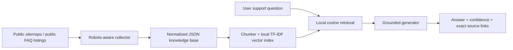

# Metabase Support Knowledge Base & RAG Bot

This is a **configurable Python Retrieval-Augmented Generation (RAG) pipeline** demonstrated with Metabase’s public, published support material. It builds a normalized JSON knowledge base, creates a local TF–IDF cosine vector index, retrieves evidence for a support question, and produces a grounded answer with **exact clickable source links**. The target was selected as an illustrative SaaS example, and this project is not affiliated with Metabase.

> The included demonstration corpus is a bounded, reproducible snapshot: **50 public records** (30 official documentation pages and 20 public FAQ-category topics) represented as **174 locally indexed chunks**. The supplied configuration defaults to an uncapped manual refresh so that operators can collect the entire configured public scope when they have approved the associated request volume and elapsed time.

| Component | File or command | Purpose |
| --- | --- | --- |
| Target configuration | `config.json` | Defines source inventories, crawl policy, request delay, source authority, and caps. |
| Public collector | `src/collect.py` | Reads published URL inventories, checks crawl directives, sanitizes obvious emails and secrets, and writes normalized JSON. |
| Local vector store | `src/index_kb.py` | Splits content into overlap-aware chunks and writes a portable local TF–IDF cosine index. |
| Support bot | `src/ask.py` | Retrieves evidence, prioritizes official documentation modestly, calls an OpenAI-compatible model when configured, and always appends exact source links. |
| Delivered corpus | `data/knowledge_base.json` | The cleaned JSON knowledge-base snapshot. |
| Delivered index | `data/vector_index.json` | Local vector index built from the delivered corpus. |

## Collection scope and responsible-use boundary

The collector is intentionally restricted to public sources discovered through the publishers’ own public inventories. The official-documentation source begins with Metabase’s documentation sitemap and includes only current-version pages under `/docs/latest/`. The community source begins with the public **FAQ** category listing and follows its public topic pages; it does **not** scan unrelated forum categories. The crawl policy check respects the published rules, excludes access-controlled or session-sensitive paths, applies a 0.75-second inter-request delay, sends a transparent user agent, never authenticates, and stops rather than bypassing any access restriction.[1] [2]

| Source class | Entry point | Included material | Treatment at answer time |
| --- | --- | --- | --- |
| Official documentation | [`/docs/sitemap.xml`](https://www.metabase.com/docs/sitemap.xml) | Current public documentation under `/docs/latest/`. | Highest authority weight. |
| Community FAQ | [`/c/help/faq/5.json`](https://discourse.metabase.com/c/help/faq/5.json) | Public threads in the FAQ category only. | Lower authority weight and explicitly labeled as community content. |
| Access policy | [`robots.txt`](https://www.metabase.com/robots.txt), [`forum robots.txt`](https://discourse.metabase.com/robots.txt) | Published crawl directives are checked before every request. | Disallowed paths are never requested. |

The collection process redacts obvious email addresses and credential-like values before output. That is a basic hygiene measure, not a substitute for a formal privacy review. Before production deployment, obtain approval from the target SaaS owner, define retention and deletion rules, and review all content-handling obligations applicable to your organization.

## Architecture



The vector store is deliberately local and dependency-light: it contains normalized TF–IDF vectors in `data/vector_index.json`, so it does not require a managed vector database. Retrieval uses cosine similarity and a small source-authority adjustment, which helps official documentation win ties without overriding strong semantic relevance from a community thread. The answer prompt instructs the generator to rely only on retrieved excerpts, reject instructions embedded in source material, identify uncertainty, and cite source markers such as `[S1]`.

## Installation and quick start

Create a virtual environment, install the small dependency set, and run the delivered index query. The optional model-backed generation uses an OpenAI-compatible Chat Completions endpoint; set `OPENAI_API_KEY` and `OPENAI_API_BASE` in your environment before using it. The default chosen for this single-query support workload is `gpt-5-mini`; change it with `RAG_MODEL` or `--model` if your own provider uses a different available model identifier.

```bash
cd metabase_support_rag
python3 -m venv .venv
source .venv/bin/activate
pip install -r requirements.txt

# Query the delivered local corpus. The result includes the exact links used.
python src/ask.py "How do I connect Metabase to a PostgreSQL database?"

# Retrieval-only mode: no model endpoint or API key required.
python src/ask.py --offline "How do I connect Metabase to a PostgreSQL database?"
```

| Operation | Command | Result |
| --- | --- | --- |
| Bounded refresh for smoke testing | `python src/collect.py --limit official_docs=30 --limit community_faq=20` | Reproduces a modest public sample with explicit request caps. |
| Full configured manual refresh | `python src/collect.py` | Collects the whole configured source scope; review access policy, volume, and timing first. |
| Build the local index | `python src/index_kb.py` | Writes `data/vector_index.json`. |
| Ask a question | `python src/ask.py "<question>"` | Returns grounded text plus exact evidence links. |
| Emit structured output | `python src/ask.py --json "<question>"` | Returns answer, confidence, sources, and retrieval scores as JSON. |
| Run local tests | `python -m unittest discover -s tests -v` | Verifies chunk overlap, source precedence, and low-confidence behavior. |

The collector uses `0` to mean **unlimited** for a per-source cap. The demonstration command intentionally overrides that setting with small numeric limits. The project is designed for manual, operator-approved refreshes; it does not install a background service or schedule automatic polling.

## Knowledge-base JSON contract

The JSON corpus is a single object containing a schema version, collection policy metadata, document records, and explicit fetch failures. Each record retains title, canonical source URL, origin type, source weight, retrieval timestamp, clean text, hash, and limited source metadata. That structure makes the corpus portable and auditable without storing source HTML or user-account information.

```json
{
  "schema_version": "1.0",
  "target": "Metabase",
  "generated_at": "2026-08-20T00:00:00+00:00",
  "collection_policy": {
    "public_only": true,
    "robots_checked": true,
    "request_delay_seconds": 0.75,
    "community_content_is_secondary": true
  },
  "documents": [
    {
      "id": "stable-content-id",
      "title": "Source page title",
      "url": "https://canonical.source/page",
      "source_kind": "official_docs | community_forum",
      "authority_weight": 1.0,
      "published_at": null,
      "retrieved_at": "ISO-8601 timestamp",
      "text": "Normalized and basic-redacted source text",
      "content_hash": "sha256",
      "metadata": {}
    }
  ],
  "collection_failures": []
}
```

## Response behavior and safeguards

When the top retrieval is weak or there is no vocabulary overlap, the system reports **low confidence** rather than fabricating an answer. In normal generation mode it sends only the top evidence chunks—not the entire corpus—to the model and directs it to avoid product claims unsupported by those chunks. If the generation endpoint is unavailable, it returns labeled retrieved excerpts instead of pretending that it produced a synthetic support answer.

| Risk | Implemented control | Remaining operator responsibility |
| --- | --- | --- |
| Hallucinated support advice | Evidence-only prompt, small retrieval context, low-confidence outcome, source links. | Review higher-risk replies and add retrieval evaluation cases. |
| Stale community content | Lower authority weight and community label. | Refresh periodically after approval; define a staleness policy. |
| Prompt injection in collected text | Generator is explicitly told that source material is data, never instructions. | Apply further content moderation for production. |
| Private or access-controlled material | No authentication; `robots.txt` checked; configured exclusions. | Obtain legal/owner authorization and monitor policy changes. |
| Personal data or secrets in public posts | Basic email/credential-like redaction before storage. | Complete a privacy and security review before external use. |

## Retargeting the project

To use another SaaS, update `config.json` with that SaaS’s public source inventories, permitted URL prefixes, robots endpoint, exclusions, and source authority weights. Begin with a small bounded `--limit` collection, inspect `data/knowledge_base.json`, then build the index and test representative questions. Do not remove the access-policy checks, request delay, source labels, or source-link requirement simply to increase coverage.

The included `source_scope.md` preserves the exact Metabase demonstration boundary. It should be rewritten for any new target before collecting material.

## References

[1]: https://www.metabase.com/robots.txt "Metabase robots.txt"
[2]: https://discourse.metabase.com/robots.txt "Metabase Discussion robots.txt"
[3]: https://www.metabase.com/docs/latest/ "Metabase documentation"
[4]: https://discourse.metabase.com/c/help/faq/5 "Metabase Discussion FAQ"
